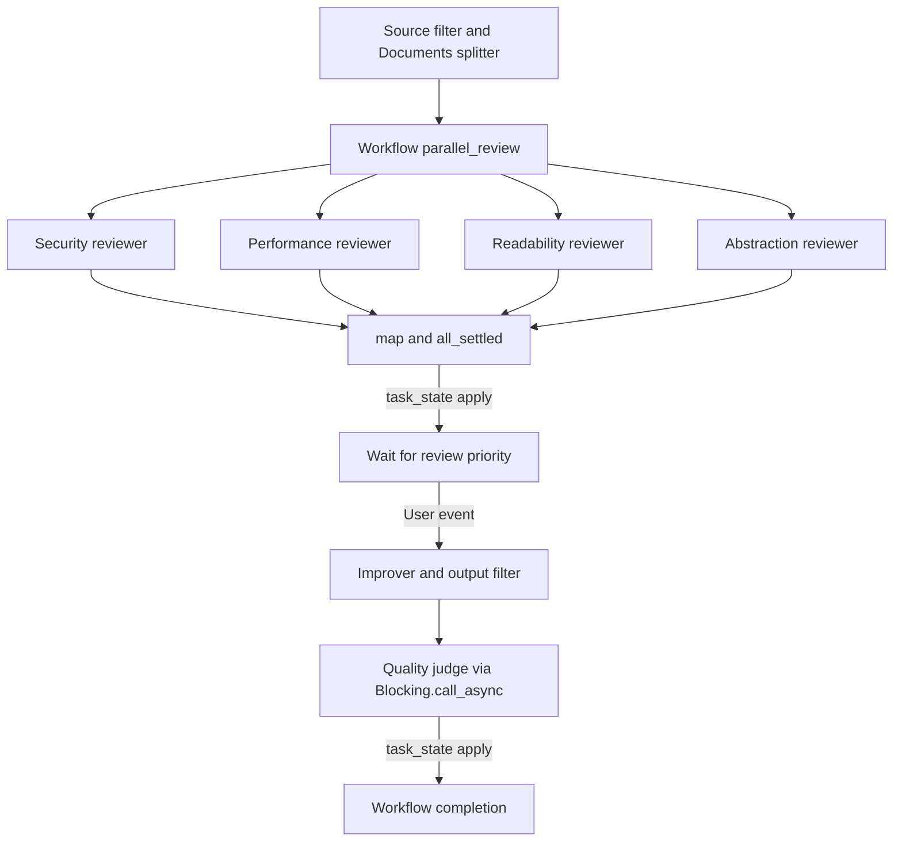

# 14 AI Code Review Pipeline

A larger example that composes Phronomy Workflow, stateful Agents,
Journal-backed Knowledge, asynchronous Agent execution, Filters, application-level quality scoring,
and tracing into one application flow.

## Current Phronomy features

| Feature | API | Usage |
|---|---|---|
| Input/output boundary | `Phronomy::Filter::Base` | Validates source input and improved-code output |
| Source splitting | `Phronomy::Documents::Splitter::RecursiveSplitter` | Splits large Ruby files for reviewer calls |
| Workflow | `Phronomy::Workflow.define` | Models the full review lifecycle |
| Typed state | `Phronomy::WorkflowContext` | Carries source, chunks, findings, selection and result |
| Workflow HITL | `wait_state` + `transition on:` | Pauses until the user chooses a review priority |
| State-owned Task completion | `task_state` | Applies review, improvement and evaluation results before transitions |
| Agent lifetime | `Agent.open_scope` + scoped create/load | Releases reviewers and improver after each complete review; batch reviewers after each chunk; preserves saved history |
| Agent | `Phronomy::Agent::Base` | Four reviewers plus a stateful improver |
| Agent async lifecycle | `Agent#invoke_async` | Reviewer and Improver work never blocks a Workflow EventLoop action |
| Result composition | `TaskResult#map` + `TaskResult.all_settled` | Extracts findings and gathers every review in input order, including failed or cancelled children |
| Persistent Knowledge | `knowledge:` | Reviewer criteria / improvement policy become Journal context candidates |
| Prompt template | `Agent::Context::Instruction::PromptTemplate` | Builds the improvement request |
| Synchronous-work boundary | `Phronomy::Blocking.call_async` | The direct RubyLLM quality-judge call is isolated from EventLoop by the bounded OffloadPool |
| Tracing | `Phronomy::Tracing::Base` | Captures major pipeline stages |

`Phronomy::Testing::Eval` is intentionally **not** used by this production-style
application example. Eval is test support in current Phronomy. The two quality
scores here are implemented as an application service and the direct
synchronous RubyLLM request is submitted through `OffloadPool`.

The reviewer policies are ordinary application data registered as Agent
`knowledge:`. They participate in the Journal/candidate/context-policy pipeline
instead of using removed static-Knowledge APIs.

`OffloadPool` is used only to keep synchronous work off EventLoop. It is not a
Workflow scheduler and does not imply CPU isolation or distributed execution.

## Parallel review results

`start_parallel_reviews` starts all reviewer/chunk calls and returns one composed
`TaskResult`. Phronomy owns synchronization and completion bookkeeping. The
application groups successful findings by reviewer, joins them in source-chunk
order and warns about excluded failures. A result-conversion error becomes a
failed child result, so it cannot leave the application waiting for a manually
maintained completion count.

Warnings are emitted after **all** child results settle, in reviewer/chunk order.
One failed or cancelled child does not cancel its peers. If every child fails,
each reviewer still has an empty string; this does not mean that the source
passed review. Retry and deadline policy are unchanged. DX05-E now owns Agents in one scope per review, including the priority pause and resume. The scope is injected into the Workflow; the improver history survives unloading and is loaded by the next review. See the
[DX05-C before/after comparison and acceptance](../docs/dx05-review-composition.md).

## Run

```bash
bundle exec ruby 14_code_review/run.rb path/to/your_file.rb
```

To bypass the interactive priority prompt:

```bash
bundle exec ruby 14_code_review/run.rb path/to/your_file.rb security
```

Batch review:

```bash
bundle exec ruby 14_code_review/batch_review.rb
```

The batch command opens one Agent scope per source chunk. It acquires all four
reviewers before starting calls, waits for all calls it started, then releases
their live ownership. Saved Agent data is not deleted. A provider failure keeps
partial findings and warnings; a construction or synchronous start failure
aborts with its original exception after safe cleanup is attempted. See the
[batch follow-up and acceptance](../docs/dx05-agent-scope-examples.md#v0290-follow-up-batch-review-ownership).

## Flow



No application `Thread.new` is required. Logical asynchronous coordination is
represented by Phronomy TaskResults consumed by task states; synchronous
third-party work that must not run on EventLoop is isolated by `OffloadPool`.
