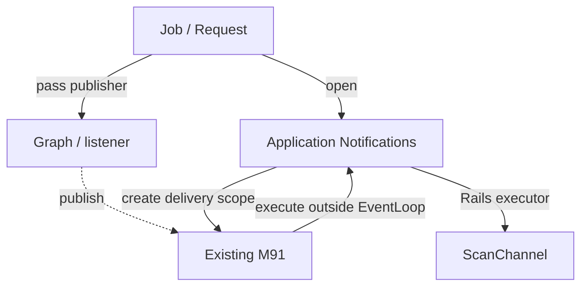

# DX05-B Separate notification delivery from business processing

> Follow-up: [DX05-E P6](dx05-agent-scope-examples.md) adds Agent ownership. The before/after code below records the earlier DX05 unit; current application graph/review builders also receive `agents:`.


## Problem and purpose

Scan decisions and command execution have different responsibilities from reporting progress to the UI. Previously, Workflow nodes and Agent listeners sent directly through ActionCable, allowing a slow notification destination to delay EventLoop processing. Making delivery asynchronous alone would still leave each Job responsible for completion, ordering and delivery failures.

Each Job now opens a notification scope, and nodes and listeners submit their payloads to its publisher. The existing `Phronomy::Integrations::OrderedEventDelivery` (M91) owns the queue, worker, snapshots, ordering and drain at scope exit. Rails integration and application messages remain in `CveScanner::Notifications`. This change adds no core API or exception class.

## Responsibilities and dependencies

| Owner | Responsibility |
|---|---|
| Job / Controller | Select the scan, persist business state and choose where to open a notification scope |
| Graph / node / Agent listener | Choose progress and result payloads; receive the publisher through explicit arguments |
| Application Notifications | Resolve the scan destination, send inside the Rails executor and report business failures to the UI |
| Existing M91 | Bounded queue, plain-data snapshots, admission-order delivery, close/drain and primary-error preservation |
| Existing C04 Agent / C02 Workflow | Execute Agents and advance Workflows without depending on ActionCable or the Scan model |

The following diagram shows the delivery path. The dotted arrow represents notification payloads supplied by business processing.



Core remains at `c673c958cd15407fb4552b6e0eca42175ec73ab7`. No Contract dependency is added, so the shared Contract SVG dependency edges need no update. This change aligns application use of existing M91; it does not move Rails or business-state persistence into M91.

## Application code before and after

The following comparisons use the actual examples baseline `fab50e681a36d7629f270adb67876248e39033b7` and this candidate. Each comparison covers the same method. The shared adapter is additional code; fewer total lines are not the justification for this change.

### Chat Job: before

The Job sent directly and swallowed business exceptions after reporting them to the UI. The existing `build_context` method is unchanged.

```ruby
def perform(scan_id, question)
  scan = Scan.find(scan_id)
  context = build_context(scan, question)

  accumulated = +""

  ScanChannel.broadcast(scan_id, {
    type: "chat_turn_start",
    role: "ChatAgent",
    prompt_preview: question.slice(0, 200)
  })

  agent = CveScanner::ChatAgent.new(
    on_event: ->(event) {
      next unless event.type == :token

      token = event.payload[:content].to_s
      accumulated << token
      ScanChannel.broadcast(scan_id, {type: "llm_token", role: "ChatAgent", token: token})
    }
  )
  result = agent.stream(context)

  raw = (result.is_a?(Array) ? result.first : result)&.dig(:output).to_s.strip
  content = raw.empty? ? accumulated : raw
  ScanChannel.broadcast(scan_id, {type: "chat_turn_done", role: "ChatAgent", content: content})
rescue StandardError => e
  ScanChannel.broadcast(scan_id, {type: "error", message: e.message})
end
```

### Chat Job: after

The Job declares notification payloads and their scope. Shared code handles delivery, drain and failure reporting while preserving the primary exception.

```ruby
def perform(scan_id, question)
  CveScanner::Notifications.open(scan_id: scan_id) do |notifications|
    scan = Scan.find(scan_id)
    context = build_context(scan, question)

    accumulated = +""

    notifications.publish(
      type: "chat_turn_start",
      role: "ChatAgent",
      prompt_preview: question.slice(0, 200)
    )

    agent = CveScanner::ChatAgent.new(
      on_event: ->(event) {
        next unless event.type == :token

        token = event.payload[:content].to_s
        accumulated << token
        notifications.publish(type: "llm_token", role: "ChatAgent", token: token)
      }
    )
    result = agent.stream(context)

    raw = (result.is_a?(Array) ? result.first : result)&.dig(:output).to_s.strip
    content = raw.empty? ? accumulated : raw
    notifications.publish(type: "chat_turn_done", role: "ChatAgent", content: content)
  end
end
```

### Shared adapter reused by every entry point (complete code)

This adds code, but avoids putting a queue, worker and secondary-failure handling into every Job. Rails dependencies are resolved by the calling Job or Request; the delivery worker uses the Rails executor.

```ruby
# frozen_string_literal: true

require "phronomy/integrations/ordered_event_delivery"

module CveScanner
  # Application-owned routing and error messages. M91 owns the delivery queue,
  # payload snapshots, worker, ordering and drain; it knows nothing about Rails.
  module Notifications
    module_function

    def open(scan_id:)
      # Resolve Rails dependencies on the calling Job/request, before delivery.
      channel = ScanChannel
      executor = Rails.application.executor
      deliver = ->(payload) {
        executor.wrap { channel.broadcast(scan_id, payload) }
      }

      Phronomy::Integrations::OrderedEventDelivery.open(
        deliver: deliver, capacity: 256, batch_size: 32, flush_timeout: 30
      ) do |delivery|
        begin
          yield delivery
        rescue StandardError => primary
          report_failure(delivery, primary)
          raise
        end
      end
    end

    def report_failure(delivery, primary)
      delivery.publish(type: "error", message: primary.message)
    rescue StandardError => secondary
      begin
        Rails.logger.error("Scan notification failed: #{secondary.class}: #{secondary.message}")
      rescue StandardError
        # Preserve the original application failure, even if reporting fails.
      end
    end
    private_class_method :report_failure
  end
end
```

### Scan Job: before

Business processing, persistence and the final notification shared one rescue boundary. Failure of only the final notification could therefore overwrite a successfully saved state with error.

```ruby
def perform(scan_id, cve_ids)
  scan = Scan.find(scan_id)
  scan.update!(status: "running")
  broadcast(scan_id, {type: "status", message: "Starting scan for: #{cve_ids.join(", ")}"})

  graph = CveScanner.build_graph(scan_id: scan_id)
  state = graph.invoke({cve_ids: cve_ids}, config: {workflow_instance_id: "scan_#{scan_id}"})

  self.class.handle_state(scan, state)
rescue StandardError => e
  scan&.update!(status: "error")
  broadcast(scan_id, {type: "error", message: e.message})
  raise
end
```

### Scan Job: after

Initial execution, approval resume and follow-up resume use the shared `with_scan` method. Each entry point describes the business work for that invocation.

```ruby
def perform(scan_id, cve_ids)
  self.class.with_scan(scan_id) do |scan, notifications|
    scan.update!(status: "running")
    notifications.publish(type: "status", message: "Starting scan for: #{cve_ids.join(", ")}")
    graph = CveScanner.build_graph(notifications: notifications)
    graph.invoke({cve_ids: cve_ids}, config: {workflow_instance_id: "scan_#{scan_id}"})
  end
end
```

The following shared method separates persistence from the final notification. `persist_state` saves the state and returns a plain Hash payload. The final publish and drain at scope exit run outside the rescue boundary for business processing and persistence.

```ruby
def self.with_scan(scan_id)
  CveScanner::Notifications.open(scan_id: scan_id) do |notifications|
    scan = nil
    payload = begin
      scan = Scan.find(scan_id)
      state = yield scan, notifications
      persist_state(scan, state) if state
    rescue StandardError
      record_failure(scan)
      raise
    end

    # Outside the business/persistence rescue: a delivery error must not
    # overwrite a successfully saved done/awaiting status.
    notifications.publish(payload) if payload
  end
end

def self.record_failure(scan)
  scan&.update!(status: "error")
rescue StandardError => secondary
  begin
    Rails.logger.error("Scan failure status could not be saved: #{secondary.class}: #{secondary.message}")
  rescue StandardError
    # Preserve the original business/persistence error even if logging fails.
  end
end
```

The complete `persist_state` method follows. It retains the decisions, saved data and UI payloads from the previous `handle_state`, returning the payload instead of sending it. The complete initial and two resume entry points are in `app/jobs/scan_job.rb`.

```ruby
def self.persist_state(scan, state)
  # Individual nodes now publish their own informational messages in
  # real-time (gather, check_cve_data, run_checks, run_remediation).
  # We no longer replay state.messages here to avoid duplicate and
  # out-of-order log lines.

  if state.halted?
    # Determine what kind of approval is needed based on current phase.
    pending_phase = state.phase
    if pending_phase == :awaiting_check_approval
      commands = state.proposed_checks
      persisted_state = state.to_h.merge(
        "workflow_instance_id" => state.workflow_instance_id,
        "phase"     => state.phase.to_s
      )
      scan.update!(
        status: "awaiting_check",
        state_json: persisted_state
      )
      {
        type: "awaiting_approval",
        approval_type: "check",
        round: state.check_iteration,
        commands: commands
      }
    elsif pending_phase == :awaiting_remediation_approval
      commands = state.proposed_remediations
      persisted_state = state.to_h.merge(
        "workflow_instance_id" => state.workflow_instance_id,
        "phase"     => state.phase.to_s
      )
      scan.update!(
        status: "awaiting_remediation",
        state_json: persisted_state
      )
      {
        type: "awaiting_approval",
        approval_type: "remediation",
        round: state.remediation_iteration,
        commands: commands
      }
    elsif pending_phase == :awaiting_followup
      # Report is ready; pause and wait for the user's first follow-up message
      persisted_state = state.to_h.merge(
        "workflow_instance_id" => state.workflow_instance_id,
        "phase"     => state.phase.to_s
      )
      scan.update!(
        status: "awaiting_followup",
        state_json: persisted_state
      )
      {type: "awaiting_followup", message: "Scan complete. Ask a follow-up question or type 'done' to finish."}
    end
  else
    # Pipeline completed — build per-CVE detail for UI
    cve_details = state.vulnerability_status.transform_keys(&:to_s).each_with_object({}) do |(cve_id, _), h|
      raw_info = state.cve_infos[cve_id] || state.cve_infos[cve_id.to_sym] || {}
      info = raw_info.transform_keys(&:to_s)
      pkgs = info["packages"]
      pkg_names = pkgs.is_a?(Hash) ? pkgs.keys.first(5) : []
      h[cve_id] = {
        priority:    info["priority"]    || "unknown",
        description: info["description"] || "",
        packages:    pkg_names,
        reasoning:   (state.vulnerability_reasoning[cve_id] || state.vulnerability_reasoning[cve_id.to_sym] || "")
      }
    end

    scan.update!(
      status: "done",
      result_json: {
        vulnerability_status: state.vulnerability_status,
        check_iterations: state.check_iteration,
        remediation_iterations: state.remediation_iteration,
        messages: state.messages
      }
    )
    {
      type: "done",
      vulnerability_status: state.vulnerability_status,
      check_iterations: state.check_iteration,
      remediation_iterations: state.remediation_iteration,
      cve_details: cve_details
    }
  end
end
```

## Notification scopes and compatibility

A fresh publisher is created for each `ScanJob#perform`, `.resume`, `.resume_followup` and `ScanChatJob#perform`. Notifications are drained when a Job exits at an approval or follow-up wait. A resumed Job does not reuse the old publisher. The operator-note HTTP Request uses the same adapter and enqueues the Chat Job after notification drain.

The graph's application-internal keyword changes from `scan_id:` to `notifications:`. Calls that need no notifications can still omit it or pass `notifications: nil`. The graph no longer depends on `ScanChannel` or a scan ID. Public Phronomy APIs, notification types and fields, the UI and the DB schema are unchanged. All 25 graph payloads were also compared against the baseline using Ruby ASTs with source locations removed.

Ordering is admission order within one delivery scope. This change does not provide global ordering across concurrent Jobs for the same scan, a durable queue, exactly-once delivery or browser acknowledgements. Queue payloads contain plain data, not Agents, Exceptions, ActiveRecord models, WorkflowContexts or Procs.

Capacity is 256, batch_size is 32 and flush_timeout is 30 seconds. Capacity bounds the waiting queue; an active batch is separate. The timeout limits waiting during close and does not forcibly stop an in-flight network operation. Normal completion requires every producer to finish and the scope's delivery to complete.

## Error handling

| Situation | Result |
|---|---|
| Business success and delivery success | Drain notifications and return normally |
| Business failure | Attempt an error notification and re-raise the original exception; attempt to save error for an unfinished Scan |
| Business failure plus error-save, notification or diagnostic failure | Preserve the first business exception |
| Business success plus delivery failure | Return the delivery failure to the caller; retain saved done/awaiting state |
| Final notification publish failure | Retain saved state in the same way |
| Queue overflow inside a listener | Inspect the original `OrderedEventDelivery::OverflowError` and reason code through the existing `StreamCallbackError` cause |
| Flush timeout | Raise `Phronomy::TimeoutError`; this does not imply physical delivery has stopped |

The Chat Job now reports failure instead of swallowing its exception. No retry is added. Acceptance tests also check that the four Job entry points have no new automatic retry handler. Notification failures alone do not automatically rerun LLM or shell work. Applications remain responsible for re-execution policy if operators configure their own retries.

Agent release remains DX05-E, and shared Workflow completion handling remains DX05-D. A future Agent scope should wrap the notification scope, preserving the order: producer completion, notification drain, then Agent release. This B implementation does not use an unavailable scope API.

## Verification

Run the following in the real Rails environment against released Phronomy 0.29.0. Leave `PHRONOMY_PATH` unset unless testing an explicit local framework checkout.

```bash
unset PHRONOMY_PATH
export RAILS_ENV=test
export PHRONOMY_MODEL=gpt-4o-mini
export PHRONOMY_BASE_URL=https://example.test/v1
export PHRONOMY_API_KEY=test-only
bundle install
bundle exec rails db:prepare zeitwerk:check
bundle exec rspec spec/lib spec/jobs spec/requests
```

There are 29 new cases (11 delivery, 17 Job and 1 Request) and 46 existing CVE cases, for 75 total. They exercise real Agents, Tools, Workflows, the Rails executor and Scan records; LLM HTTP responses, external shell/scraper results and the ActionCable server transport are stubbed. They cover Agent progress during slow delivery, admission order and snapshots, overflow, primary errors, four saved states with final publish/drain failures, approval waits and fresh publishers on resume. They do not test the browser GUI or connectivity to an external Cable backend.

Existing CVE unit specs also follow the current `stream_async` API and publisher. The existing CVE Rails CI job now runs the 75 tests as well as boot checks. The configured 13-job CI structure is unchanged.

The root `bash scripts/verify_offline.sh` also verifies 79 root cases, 139 SQLite cases, syntax for 268 Ruby files and SQLite fresh-pool reload. The package author did not rerun the full core suite, PostgreSQL, live LLM, GUI, full `verify_examples.sh` or remote CI for this candidate. Distinguish post-application CI results from the previous C candidate's CI success.
